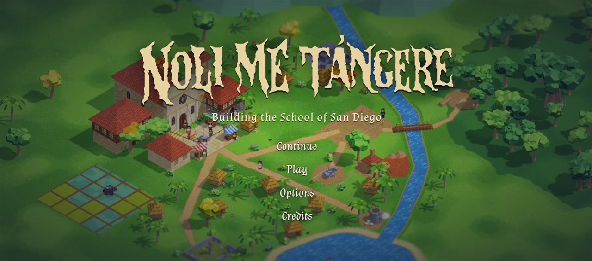
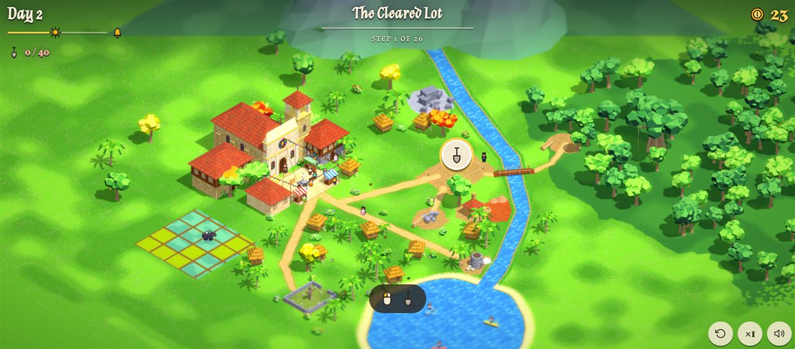
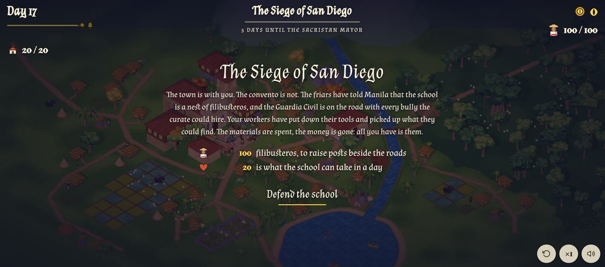
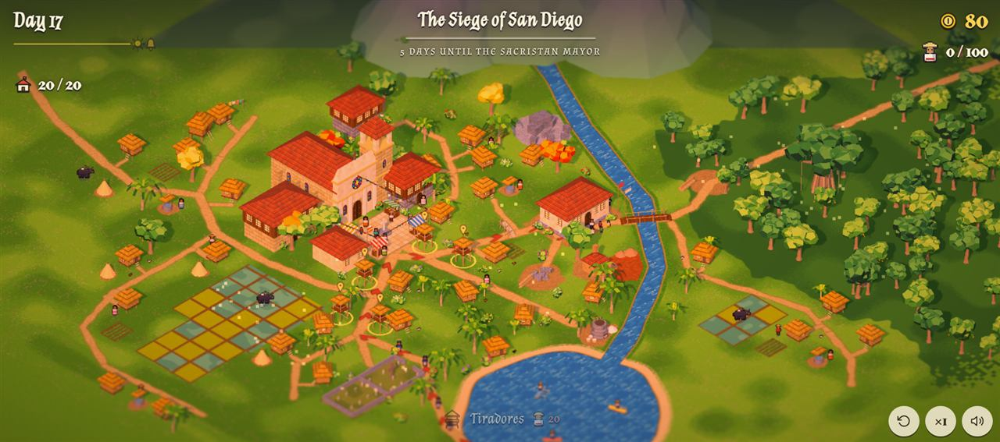
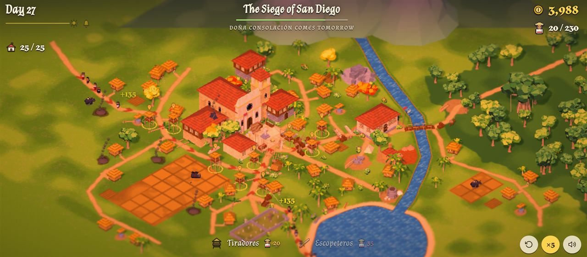
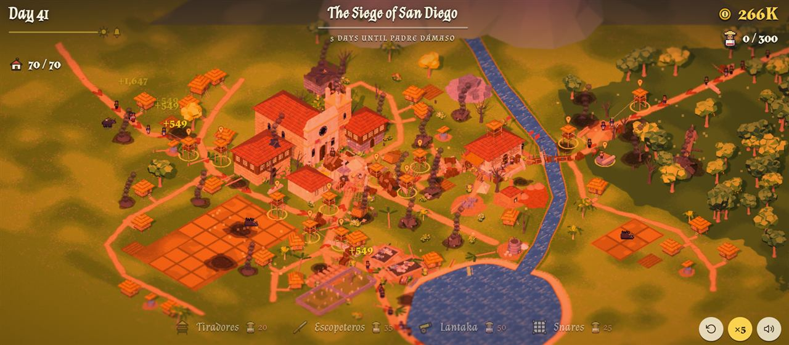
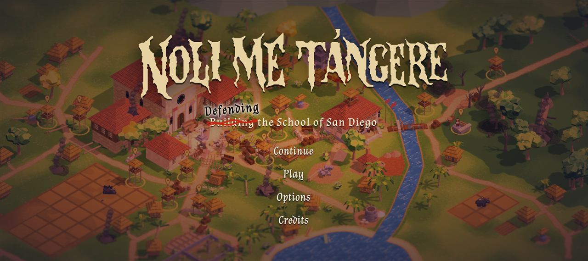

# Noli me Tangere: Building the School of San Diego

An incremental game after José Rizal's *Noli Me Tangere*. You are Crisóstomo Ibarra, and you are building a school in San Diego. The game has two parts, each about an hour long:

1. **Building.** Days last 8 seconds at first. You gather materials by clicking, spend the nights on a tree of bonuses, and raise the school in twenty steps.
2. **Defending.** The friars and the Guardia Civil march on the finished school. You hold it with posts of filibusteros beside the roads, for as many days as you can, against five leaders in turn.

It runs in a browser, in 3D with painted pixel-art sprites, and needs no install.

## Run

Open `index.html` in a browser. Nothing to install and nothing to build; three.js is vendored in `vendor/`. The game saves itself in the browser.

## Screenshots

| | |
|---|---|
|  |  |
| *Day 2. Click the marker over the works to dig.* | *Day 8. Workers hired, a new household settling, a second place opened.* |
|  |  |
| *Night. The tree of bonuses, with the school at its centre.* | *The last stage: five places, two kilns, and the town grown round them.* |
|  |  |
| *The school is finished. Everything you had is gone.* | *Posts raised beside the roads, with their rings and pins.* |
|  |  |
| *Day 27. Barricades, burnt huts, the red tint of war.* | *Day 41. Ruins all round a school still standing.* |

Once the school is built, the title reads *Defending* over a struck-out *Building*.

## Play

The interface is pictograms and plain lettering laid over the town; hover over anything to read what it is.

- **Gather.** Round markers float over the places where work is done: the works (labour), Ibarra's wood (timber), the quarry (stone), the clay pit (clay, fired into bricks by the kiln) and the lake shore (shells, burned into lime). Click a marker to work there; a click counts on the marker or just around it (about one and a half times its size), not elsewhere on the map. Only the works are open at first; the others open as the school rises.
- **Kilns.** The brick kiln and the lime kiln work all day on their own. Click one to stoke it: each click fires half a second of its work at once.
- **Donors.** Coins and visitors pop up in the plaza for a few seconds. Click them.
- **Interruptions.** A friar, the Guardia Civil, a cloudburst or the crocodile stops all work at one place until you click it away. Bonuses in the tree later send them off without you.
- **The length of the day.** Two bonuses stretch it: lamps at the works add one second per level, and the bell-ringers hold the Angelus back one second for each donor, visitor or interruption you deal with, up to their level each day.
- **Night.** When the day is over the Angelus rings and the tree of bonuses opens. The school is at its centre: pay the materials for the next building step there. Every fourth step completes a stage and opens a new place, a new material and new branches. Drag to move the tree, wheel to zoom, Shift-click to buy several levels.
- **The shop.** A bonus on the tree opens a shop at night: sell what you have too much of, buy what you lack. Prices follow the town's daily giving. Once every bonus paid for in a material is bought, a standing order sells each evening whatever the next step of the school does not need.
- **The convento.** The last step of each stage is blocked until you win a confrontation (the red words beside the sunrise). Wear it down by clicking before the Angelus; it is untouchable while any interruption stands. Each one fights back in its own way: some close up (the mark turns dark, and a click then costs you daylight), some show openings beside them that count for six clicks, some recover while an interruption stands, one (the Alférez) cannot be clicked at all and is beaten by seeing off six of his patrols, and one keeps your people at home. Losing costs nothing: try again another day.
- **The town grows.** For every five workers you hire, of any kind, a new household settles in San Diego: a hut with its path, and with it a well, a field, a haystack, a granary or a bigger cemetery. There are twenty to come.
- **View.** Q / E or the corner button rotate the view. The mouse wheel zooms. Drag the map (or use the arrow keys) to move it; it stops at the edge of the painted country, and reaches further the closer you are zoomed in.
- **Speed.** The speed button in the corner runs time at ×1, ×2 or ×5.
- **Menu.** Esc opens the menu (Continue / Options / Credits) and stops the game behind it.

## The siege

Finishing the school closes the tree of bonuses, so buy what you want first. The friars and the Guardia Civil then march on the school, and the game becomes a defence of it.

- **Filibusteros.** Everything you had is gone. Each worker you hired becomes a filibustero (a hundred if you hired them all), and they are what posts are raised with: twenty for the simplest.
- **Posts.** Choose one in the bar at the bottom, then click beside a road. The ring shows how far it reaches; it turns red where a post cannot stand (too far from a road, on one, on water, on a building or on another post). Click a post to take it down: its men all come back. Every post you raise has a gold ring on the ground and a gold pin floating over it, which shows through trees and roofs. In the siege, Esc first puts back a post in hand, if any.
  - **Tiradores:** cheap shooters from a tower.
  - **Escopeteros:** slow, hard-hitting and long-ranged.
  - **Lantaka:** a small cannon that hurts everything round the target.
  - **Snares:** they hurt little but slow the enemy down.
- **The day.** Nothing comes until you sound the alarm (Enter). The enemy then keeps coming for as long as the longest day of the first part (20 seconds), and the day ends when the last of them is down or the school is overrun. Being overrun is not the end: you keep the pesos, and try again.
- **The roads.** Three roads run to the edge of the map: south-west past the cemetery, north-west behind the church, and east through the wood. Only the first is used at the start, the second after the first leader is beaten, all three after the second. Red arrowheads run down each road in use, towards the school; where two roads join, the arrows are drawn once.
- **The enemy.** Guardia Civil, then faster cuadrilleros and other kinds as the days go on. Each day held, there are more of them and they are tougher.
- **Leaders.** Every five days a leader comes with an escort: the Sacristan Mayor, Doña Consolación, the Alférez, Padre Salvi, Padre Dámaso. If he reaches the school the day is lost and he returns the next day, with the wounds you gave him. The five days start again once he is beaten.
- **The night.** Enemies brought down pay pesos, spent on a second tree: recruits, levels for each kind of post, range, rate of fire, fire-pots, walls, an infirmary, barricades, spoils, a daily purse, and Elías.
- **The town at war.** Every day held leaves its mark, thirty steps in all, each worse than the last (beating a leader brings the town to at least step 6, 12, 18, 24, 30). The streets and the lake empty over the first three days; then come barricades and broken church windows, a cannonball through the convento roof, dead carabaos, fallen and burnt huts, the old balete felled, open graves by the cemetery, Padre Salvi on a gallows before his church, and at the end a town of ruins round a school still standing. The steps are the `STEP` list in `js/world.js`.
- **The barracks.** Each leader beaten turns the school further into one (`barracks` in `js/world.js`): boarded windows and a barred door; stacked muskets, a rack of spears, powder and sentries; a sandbag redoubt, a lookout on the ridge and the red flag; two guns and a lean-to armoury; and at last a watchtower, banked walls and a garrison.

## Menu and debug mode

Options > **Debug mode** shows:

- **Autoclick**: 1 to 100 clicks a second.
- **Stage**: a jump to the start of Construction or Tower Defense.
- **Boss**: a jump to the night before any confrontation of either part.
- **Shopping spree**: buys the bonuses each time the tree opens (and when ticked while it is open), cheapest first, topping up missing materials at the shop with pesos (never the school itself).
- **Standing order**: sells the surplus each evening for every material: Off, On (full) or On (half).
- **Resources**: a multiplier (x1 to x10, or infinite) on everything gathered, and in the siege on pesos from kills and dawn gifts. Infinite stores are never written to the save; the real amounts return when the box is unticked.

Settings are kept in their own browser key, not in the save.

## URL options for testing

- `index.html?bot=2.5` plays the whole game with a robot at 2.5 clicks a second and prints the number of days per stage, and how many tries each confrontation took, to the browser console. Use it after changing numbers in `data.js`. It counts the seconds of each day plus 15 seconds for each night.
- `?auto=1&step=9&up=2&rich=500` jumps into a day with nine building steps done, every bonus at level 2 and 500 of everything. `auto=tree` opens the tree, `auto=shop` the shop, `auto=dusk` ends a day at once, `boss=1` makes the day a confrontation.
- `?sbot=3` plays the siege three times with a robot and prints the days each took and how each leader went.
- `?auto=siege` jumps into the siege. `day=10` shows the town as ten days held leave it (0 to 30); `sw=12` sets the days already held, `sb=2` the leaders beaten, `sup=3` every siege bonus at level 3, `sp=500` the pesos, `st=8` raises eight posts, `sv=night` opens its tree and `sv=fight` sounds the alarm.
- `perf=1` shows the frame time, the number of draw calls and the drawing quality; `q=0` to `q=3` fixes the quality (0 is the sharpest).
- `houses=12` shows the town with twelve of its new households. `zoom=2` sets the zoom, `at=-15,-16` looks at that place on the map, `menu=options` / `menu=credits` / `menu=pause` and `dbgon=1` open the menu pages, `title=war` shows the title as it reads after the school is built, `light=1.6` freezes the hour (0 dawn, 0.5 noon, 1 dusk, above 1 night), `nopost=1` turns off the blur and bloom, and `top=1` looks at the map from above with north up.

## How it is made

Plain classic scripts on a `window.Noli` object, no build step, no framework. All the art is drawn in code when the page loads; there are no image files apart from the title logo.

- `js/data.js`: materials, places, stages, confrontations, the tree of bonuses and all lore text. All tuning numbers are here.
- `js/sprites.js`: all pixel art, drawn in code at load time (textures, the painted ground, people, animals).
- `js/icons.js`: the pictograms (small SVG drawings, and busts cut from the character sprites).
- `js/world.js`: the HD-2D isometric town: sprite people and animals in a lit 3D scene of plain solids, with tilt-shift blur and bloom. Performance rules: everything that never moves is welded into one mesh per material (the households that come later are welded again each time one arrives, and their paths and fields are painted into the ground); all the trees are one mesh whose sway runs on the graphics card; shadows are only redrawn when something changes or the light has moved; and the drawing resolution steps down by itself if frames run slow.
- `js/siege.js`: the siege: the posts, the enemy, its tree, and a robot player of its own.
- `js/game.js`: game state, the day, the tree, tooltips, saving, the menu and debug mode, and a robot player for measuring length.
- `style.css`, `index.html`, `fonts/`, `vendor/three.min.js` (three.js r128), `Noli_Me_Tangere.svg` (the title logo).
- `ROADMAP.md`: the original concept (older than the current design).

## Credits and licence

Based on the lore of José Rizal's *Noli Me Tangere* (1887). We took the liberty of adapting the story to move the hearts of those who, like us, yearn to see a free Philippines.

Licensed under the GNU GPL-3.0; see `LICENSE`.
