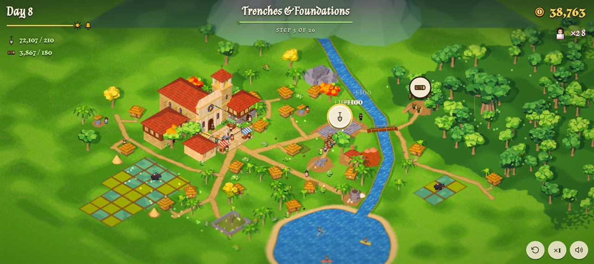
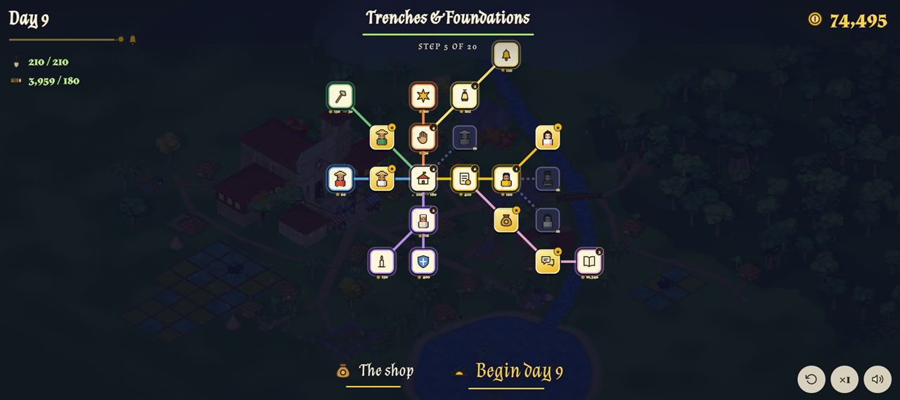
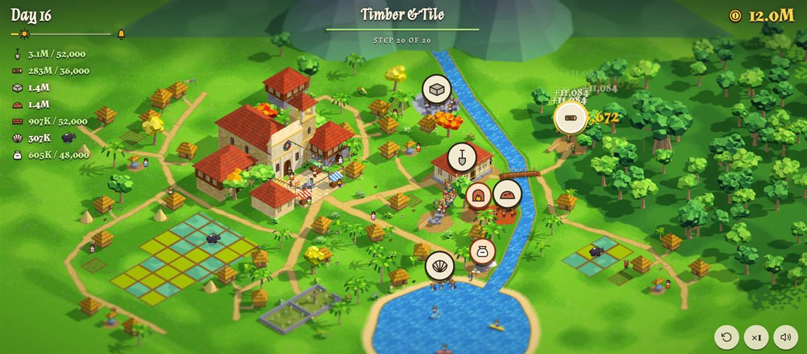
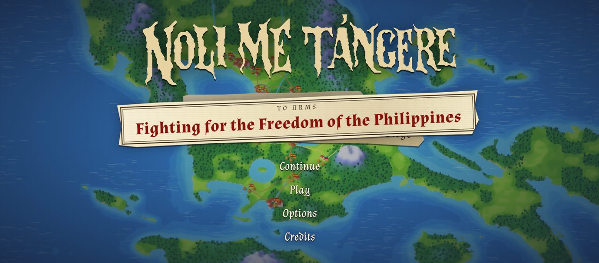
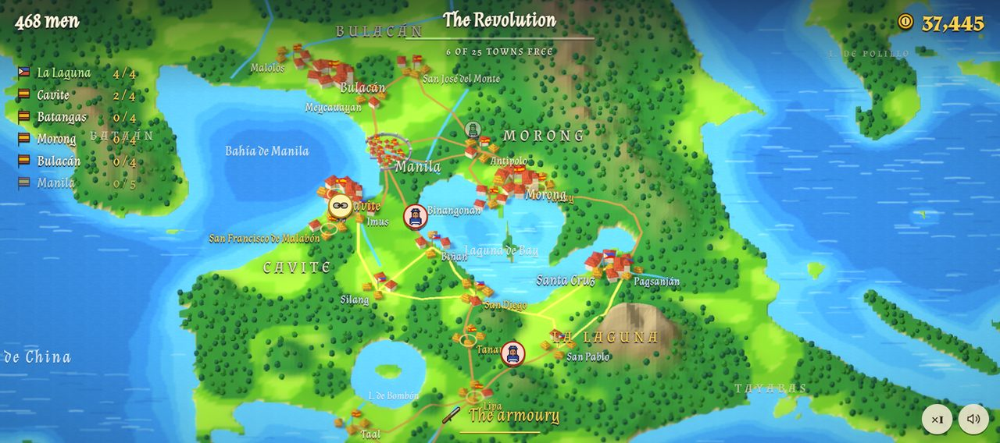
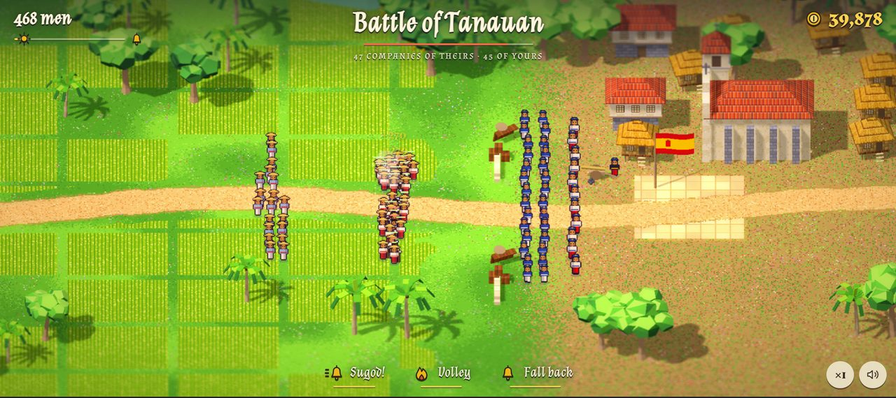
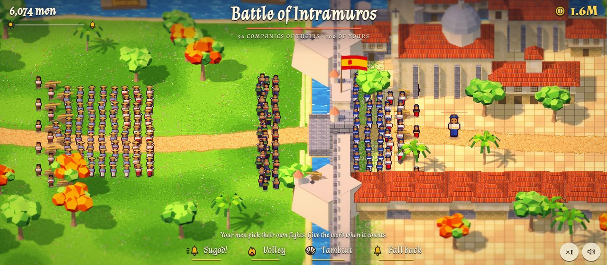

# Noli me Tangere

An incremental game after José Rizal's *Noli Me Tangere*. You are Crisóstomo Ibarra, and you are building a school in San Diego. Then you have to defend it, and then the fight leaves the village. The game has three parts, each about an hour long:

1. **Building a school in San Diego.** A clicker: gather materials by day, spend the nights on a tree of bonuses, and raise the school in twenty steps.
2. **Defending the school.** A tower defence: the friars and the Guardia Civil march on the finished school, and you hold it with posts of filibusteros beside the roads.
3. **Fighting for the freedom of the Philippines.** A campaign: the view pulls back to a map of the south of Luzon, and the towns are taken one battle at a time, down to Intramuros.

It runs in a browser, in 3D with painted pixel-art sprites. A fourth part, rebuilding Manila and the other cities, is planned.

## Run

Open `index.html` in a browser. There is nothing to install and nothing to build. The game saves itself in the browser.

## 1. Building

| | |
|---|---|
|  |  |
| *Day 2. Click the marker over the works to dig.* | *Day 8. Workers hired, a new household settling, a second place opened.* |
|  |  |
| *Night. The tree of bonuses, with the school at its centre.* | *The last stage: five places, two kilns, and the town grown round them.* |

- **Days.** A day lasts 8 seconds at first. Click the round markers over the works, the wood, the quarry, the clay pit and the lake shore to gather labour, timber, stone, bricks and lime. Donors and visitors pop up in the plaza; friars, the Guardia Civil, cloudbursts and the crocodile stop the work until you click them away.
- **Nights.** The Angelus ends the day and opens the tree of bonuses: workers, tools, longer days, a shop. The school is at its centre, and each of its twenty steps is paid for in materials. Every fourth step opens a new place and new branches.
- **Confrontations.** The last step of each stage is blocked until you win a confrontation with one of the powers of the town, each of which fights back in its own way. Losing costs nothing.
- **The town grows.** For every five workers you hire, a new household settles in San Diego.

## 2. Defending

| | |
|---|---|
|  |  |
| *The school is finished. Everything you had is gone.* | *Posts raised beside the roads, with their rings and pins.* |
|  |  |
| *Day 27. Barricades, burnt huts, the red tint of war.* | *Day 41. Ruins all round a school still standing.* |

- **Filibusteros.** Everything you had is gone. Each worker you hired becomes a filibustero, and they are what posts are raised with.
- **Posts.** Four kinds, placed beside the roads: tiradores (cheap shooters), escopeteros (slow, hard-hitting, long-ranged), the lantaka (a small cannon) and snares (which slow the enemy down). Taking one down gives all its men back.
- **The day.** Nothing comes until you sound the alarm. The enemy comes by one road at first, later by three. Being overrun is not the end: you keep the pesos and try again.
- **Leaders.** Every five days a leader comes with an escort: the Sacristan Mayor, Doña Consolación, the Alférez, Padre Salvi, Padre Dámaso. Beating the last one ends the siege.
- **The night.** Enemies brought down pay pesos, spent on a second tree.
- **The town at war.** Every day held leaves its mark on San Diego, and every leader beaten turns the school further into a barracks.

## 3. The revolution

| | |
|---|---|
|  |  |
| *The map. Six towns free, a convoy of prisoners near Cavite, columns on the roads.* | *The battle of Tanauan: the men pick their own fights.* |

*Intramuros, the last battle. Nobody passes the wall but through the gate.*

- **The map.** The south of Luzon as a table of plain solids, with its mountains, lakes and roads, and the towns and provinces of the time. San Diego stands where Calamba does. Drag to move the map, wheel to look closer.
- **Twenty-five towns.** Four in each of La Laguna, Cavite, Batangas, Morong and Bulacán, the last of each being its capital. You can attack any town joined by a road to one you hold. Manila stands behind a wall that falls only when all five provinces are free; then come its four arrabales, and Intramuros last.
- **Battles.** Nobody is sent anywhere: your men come on and pick their own fights. What is left to you is the word of command: *Sugod!* (Z), the *Volley* (X) and the *Tambuli* (C). A lost battle costs nothing but the day.
- **Every town its own field.** No two are laid out alike: Imus has its river and stone bridge, Lipa its coffee and its dome, Cavite the sea on both sides. Intramuros is drawn after the engravings of the century.
- **Men and salapi.** Money never buys men: they join you in every town you free, and when you free a convoy of prisoners. Enemies brought down pay salapi, spent in the armoury: a third tree of about thirty bonuses, much of it out of the story of the Katipunan.
- **Columns and convoys.** Spanish columns march the roads. One on a road that leaves a town of yours can be ambushed for salapi, as often as you like.

## Controls

- **View.** Drag or use the arrow keys to move, the mouse wheel to zoom, Q / E to rotate the town.
- **Speed.** The button in the corner runs time at ×1, ×2 or ×5.
- **Menu.** Esc opens the menu and stops the game behind it.
- **Help.** Hover over anything to read what it is.

## Debug mode and testing

Options > **Debug mode** gives an autoclicker, a jump to the start of any part or to any boss, automatic buying, and a multiplier on everything gathered.

Some URL options put the game in a given state:

- `?auto=1&step=9&up=2&rich=500`: a day with nine building steps done, every bonus at level 2 and 500 of everything.
- `?auto=siege&sw=12&sb=2`: the siege, with twelve days held and two leaders beaten.
- `?auto=war&wn=7&wup=3`: the revolution, with seven towns free and every bonus at level 3. Add `wv=fight&town=imus` for a battle.
- `?bot=2.5`, `?sbot=3`, `?wbot=2`: a robot plays the first, second or third part and prints how long it took to the browser console. Use them after changing numbers in `js/data.js`.
- `perf=1` shows the frame time; `q=0` to `q=3` fixes the drawing quality (0 is the sharpest).

The other options are read in `js/game.js` (search for `auto=`) and in the `debug` functions of `js/siege.js` and `js/war.js`.

## How it is made

Plain classic scripts on a `window.Noli` object, with no build step and no framework. All the art is drawn in code when the page loads; the only image file is the title logo.

- `js/data.js`: every tuning number and all the lore text.
- `js/sprites.js`, `js/icons.js`: the pixel art and the pictograms.
- `js/world.js`: the town, a lit 3D scene of plain solids with sprite people, tilt-shift blur and bloom.
- `js/game.js`: the first part, saving, the menu and debug mode.
- `js/siege.js`: the second part.
- `js/war.js`, `js/warview.js`, `js/coast.js`: the third part: its rules, its map and battlefields, and the coasts of Luzon (from the boundaries published in faeldon/philippines-json-maps).
- `vendor/three.min.js`: three.js r128.
- `ROADMAP.md`: the original concept, older than the current design.

## Credits and licence

Based on the lore of José Rizal's *Noli Me Tangere* (1887). We took the liberty of adapting the story to move the hearts of those who, like us, yearn to see a free Philippines.

Licensed under the GNU GPL-3.0; see `LICENSE`.
